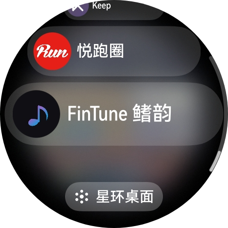
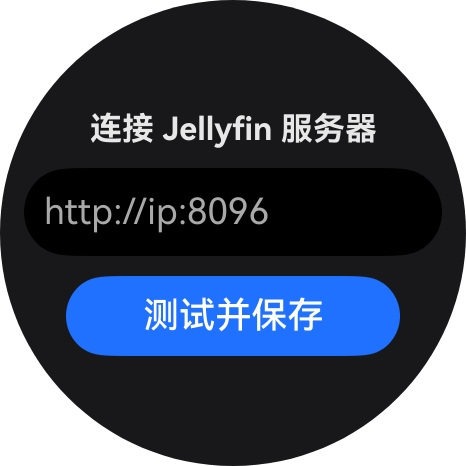
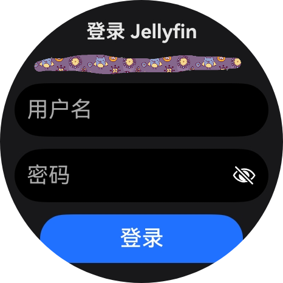
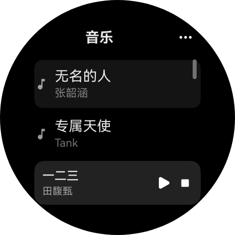
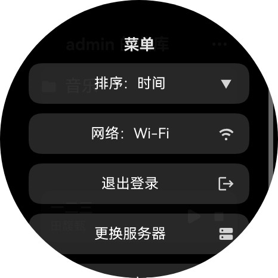
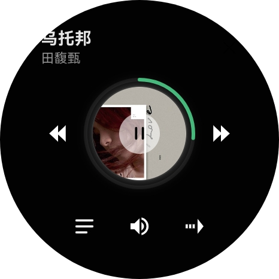

# FinTune 鳍韵

一款开源的华为手表（HarmonyOS，已适配 Watch 6 / API 26）上直接流式播放 NAS 里 Jellyfin 音乐服务器的音乐——不依赖手机，Wi-Fi 或 eSIM 独立联网。

## 为什么做这个

华为手表应用市场没有任何 Plex / Jellyfin / SMB 客户端，而手表蓝牙连手机时 eSIM 会被智能关闭、流量走极慢的蓝牙代理，在线音乐体验极差。本项目让手表直接连家里的 Jellyfin，边下边播。

## 关于 Jellyfin

[Jellyfin](https://jellyfin.org) 是一个完全开源、免费的媒体服务器软件（GPL 协议），由社区驱动，可以把你的音乐、电影、剧集、照片集中在一处，并通过网页或各类客户端随时访问。它相当于免费版的 Plex / Emby：不收费、无会员、无追踪，服务端自行部署，数据完全掌握在自己手里。

- 官网：https://jellyfin.org
- 服务端支持 Windows / macOS / Linux / Docker / 群晖等 NAS，安装包见[官方下载页](https://jellyfin.org/downloads)
- 本项目通过 Jellyfin 的 REST API 浏览曲库，并请求服务端转码流（MP3 128k）实现手表边下边播；服务器既可以是局域网 NAS，也可以是经公网代理（反代 / 内网穿透）暴露的服务器

## 功能

- **Jellyfin 账密登录**：服务器地址 + 用户名/密码，token 自动获取与持久化，全程无需手动输入 API Key
- **曲库浏览**：音乐库 → 文件夹逐级浏览（Navigation 路由，系统级返回手势），排序（名称/时间/歌手 × 升降序，持久化）
- **流式播放**：服务器端转码（MP3 128k，省流量省电），AVPlayer 边下边播
- **播放详情页**：专辑封面 + 播放进度环、上一首/下一首、顺序/单曲循环/随机、播放列表、音量调节
- **歌词**：自动兼容 Jellyfin JSON / LRC / 纯文本，当前行高亮滚动，双击行跳转
- **后台播放**：AVSession 接入播控中心 + 长时任务，熄屏继续播，蓝牙耳机/播控面板可控制
- **网络绑定**：Wi-Fi 优先、蜂窝兜底，自动避开蓝牙代理；断网自动暂停、恢复自动续播
- **弱网自愈**：请求失败自动重绑网络并重试，封面自动重载
- **状态持久化**：重启应用恢复正在播放的歌曲与队列，浏览时逐级定位到播放位置
- **表冠交互**：列表/歌词滚动（高亮居中）、详情页旋转表冠调音量
- **专为圆表设计**：所有页面避让圆形屏幕边缘，交互区居中

## 技术栈

ArkTS + ArkUI（声明式）· Stage 模型 · API 26

| 模块 | 用途 |
|---|---|
| AVPlayer | 网络流播放 |
| AVSession + BackgroundTasksKit | 播控中心、长时任务后台播放 |
| @ohos.net.http | Jellyfin REST API |
| @ohos.net.connection (`setAppNet`) | 强制 Wi-Fi/蜂窝，绕过蓝牙代理 |
| preferences | 配置与播放状态持久化 |
| Navigation + 系统路由表 | 页面栈与系统返回手势 |

## 开发设备与系统版本

- **开发 / 验证真机**：HUAWEI WATCH 6（圆表，466×466）
- **系统**：HarmonyOS 6（API 26），`targetSdkVersion` 26
- **DevEco Studio**：26+
- 其他运行 HarmonyOS 6（API 26）的华为手表理论可用，未逐一验证；更低 API 版本需自行验证 AVSession、长时任务等能力差异

## 界面截图

手表应用列表中的 FinTune 鳍韵：

连接 Jellyfin 服务器（支持局域网地址或公网代理域名）：

Jellyfin 账密登录（token 自动获取与持久化）：

曲库浏览与底部播放条：

菜单（排序切换、实时网络绑定状态查看、退出登录、更换服务器）：

播放详情页（专辑封面 + 播放进度环、切歌、音量、播放列表）：

歌词页（当前行高亮居中，支持双击行跳转）：

## 构建

1. DevEco Studio 26+ 打开工程
2. 自动签名（华为账号登录）
3. 手表开启开发者模式，`hdc` 连接后运行

## AI 共同开发声明

**本项目几乎所有代码由人与 AI（DevEco Code / 大模型编程助手）结对完成**：需求描述、方案讨论、编码、真机日志诊断、多轮迭代修复（如 AVPlayer 需显式 prepare、AVPlayer 对网络流 duration 返回不可靠、鸿蒙手表 requestFocus 的 150002 异常、KEEP_BACKGROUND_RUNNING 权限、ArcList 表冠限制等坑均为 AI 通过真机 hilog 逐一定位）。AI 负责实现与诊断，人负责真机验证与产品决策。

这证明了"零鸿蒙经验开发者 + AI"也能完成可上线的手表应用。**欢迎一切形式的二次开发和修改！**

## 已知限制

- 歌词页表冠滚动在部分 ROM 上仍不可用（触控滑动正常），系系统对表冠事件分发的限制
- 蜂窝网络下无法访问局域网 NAS（物理限制），仅 Wi-Fi 环境可播
- 锻炼 App 运动界面的三方播控能力待真机验证

## 协议

[The Unlicense](LICENSE) — 最宽松：随便用、随便改、随便分发，无需署名，没有义务。
